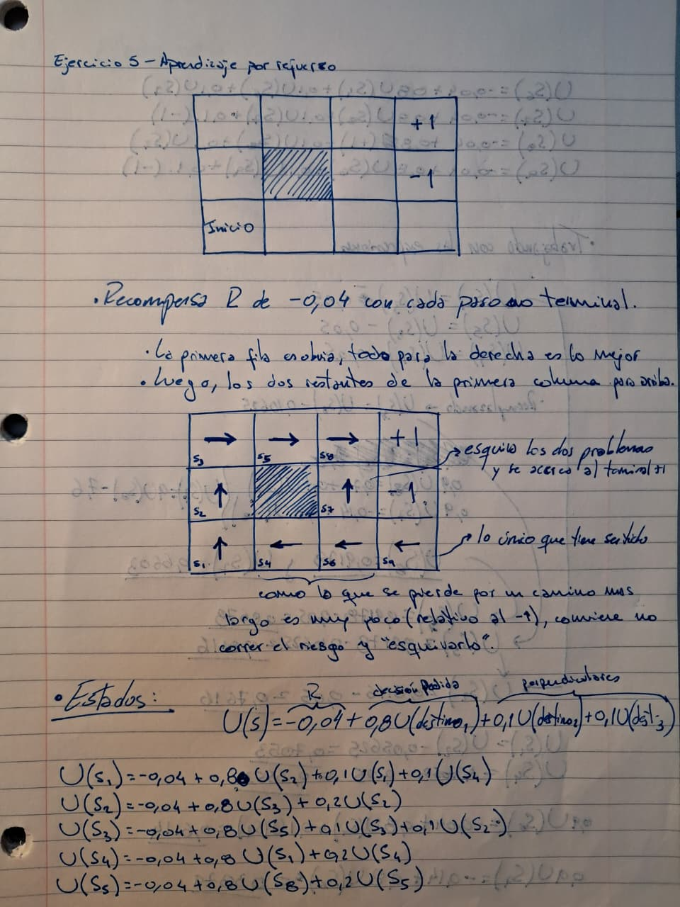
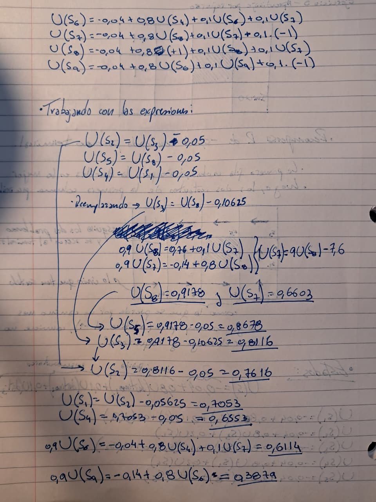
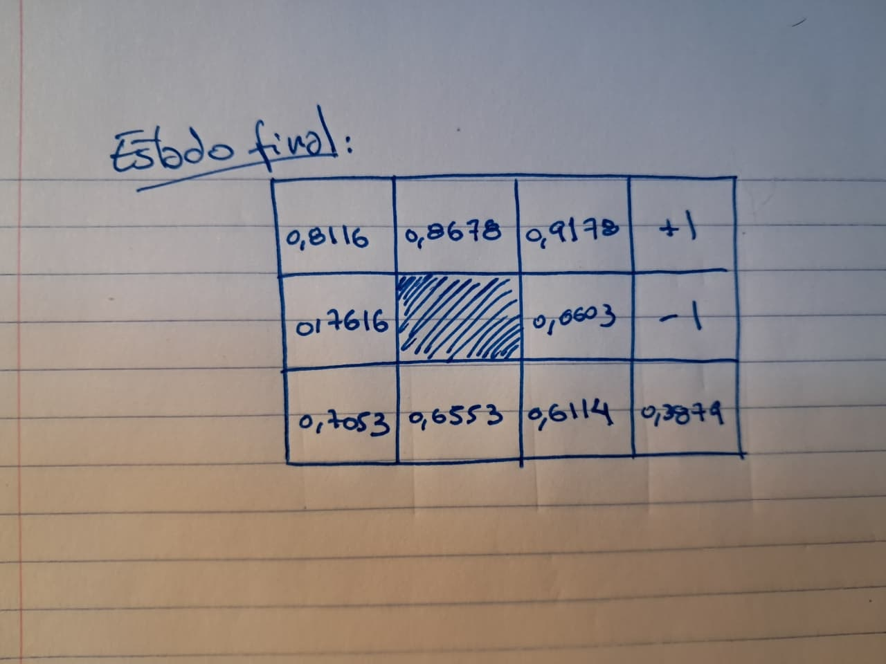

**Tópicos Selectos en Aprendizaje Maquinal - TP N°1: Algoritmos para Reconocimiento de Patrones**

**Estanislao Claucich**

### Ejercicio 5: Aprendizaje por refuerzo

Para estudiar y validar el comportamiento de los algoritmos de aprendizaje por refuerzo pasivo se proponen los siguientes ejercicios de lápiz y papel en un "problema de juguete":

1. Encontrar la política óptima para un agente pasivo en el mundo de 4x3 de la Figura 1, con recompensa $-0.04$ en los estados no terminales. En la Fig. 2 se pueden observar ejemplos de políticas posibles para este problema.
2. Calcular las utilidades de los estados en el mundo de 4x3, dada la política óptima encontrada en el ejercicio anterior.

---

### Planteo

El mundo es una grilla de $4\times3$ con una pared en $(2,2)$ y dos estados terminales: $+1$ en $(4,3)$ y $-1$ en $(4,2)$. En los 9 estados no terminales el agente cobra $R(s)=-0.04$ por paso. Se usa el modelo clásico de este problema:

- **Acciones:** arriba, abajo, izquierda y derecha.
- **Transición estocástica:** el movimiento sale como se pidió con probabilidad $0.8$ y con probabilidad $0.1$ se desvía hacia cada uno de los dos lados perpendiculares. Si el movimiento lleva contra la pared o fuera de la grilla, el agente se queda donde está.
- **Sin descuento:** $\gamma=1$.

Una política $\pi$ indica qué acción ejecutar en cada estado. Su utilidad es la recompensa total esperada al seguirla, y cumple la ecuación de Bellman para una política fija:

$$U(s)=R(s)+\gamma\sum_{s'}P\big(s'\mid s,\pi(s)\big)\,U(s'),\qquad U(s)=R(s)\ \text{en los terminales}.$$

Esto da una ecuación lineal por cada estado no terminal, es decir, 9 ecuaciones con 9 incógnitas. La política óptima es la que en cada estado elige la acción de mayor valor esperado $\sum_{s'}P(s'\mid s,a)\,U(s')$.

---

### Resolución a mano

---

### Conclusiones

1. **Política óptima.** Con $R=-0.04$ conviene la ruta larga y segura, subir por la columna 1 y avanzar por la fila superior hacia el $+1$. Desde $S_4$, $S_6$ y $S_9$ conviene retroceder hacia la izquierda, porque lo que se pierde por el camino más largo es muy poco frente al riesgo de caer en el $-1$.
2. **Utilidades.** Fijada la política, las 9 ecuaciones de Bellman se resuelven por sustitución.
3. **Estados de menor utilidad.** $S_9$ y $S_7$ son los más bajos ($0.388$ y $0.660$) porque están junto al estado $-1$, y en cada intento hay probabilidad $0.1$ de caer en él.
